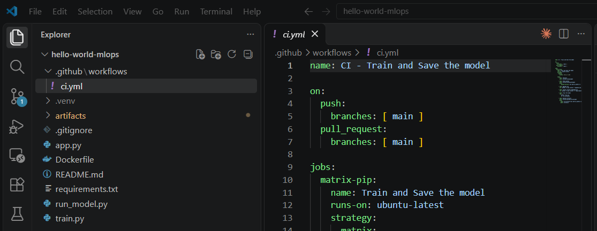
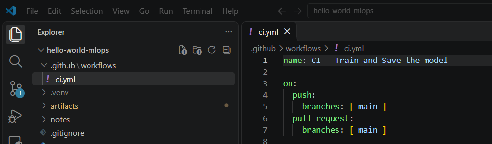

# How MLOps Engineers Help Data Scientists

Before automation, Data Scientists usually train models by:

Running scripts manually

Clicking “Run” in a notebook

Training only on their local machine

This does not scale and is hard to repeat.

MLOps Engineers fix this using CI (Continuous Integration) with GitHub Actions.

### Training Becomes an Automatic Event

Instead of a human triggering training, MLOps Engineers define rules such as:

Train the model when new code is pushed

Train the model when data changes

Train the model when a pull request is merged

Now training is:

Predictable

Consistent

Not dependent on someone’s laptop.

### Standard Training Environment

Local machines differ:

Different Python versions

Different library versions

Different OS settings

MLOps Engineers ensure:

Every training run uses the same environment

Same dependencies every time

Same Python version

This removes the classic problem:

“The model worked on my machine but not in CI.”

### Clean, Fresh Training Every Time

Each CI run starts from a clean environment:

No leftover files

No cached results

No manual tweaks

This ensures:

Training is reproducible

Results are trustworthy

Hidden dependencies are eliminated

### Automatic Model Generation

When CI runs:

The training script executes automatically

A new model is produced

The model represents the latest code + data

Data Scientists don’t need to:

Run training manually

Share model files over chat or email

### Consistent Experiment Tracking

Every CI training run is linked to:

A Git commit

A timestamp

A specific change

This makes it easy to answer:

Which code created this model?

What changed between two models?

Why did accuracy improve or drop?

### Early Failure Detection

If something breaks:

Dependency issues

Data format problems

Training errors

CI fails immediately and visibly.

This helps Data Scientists:

Catch issues early

Fix problems before deployment

Avoid broken models reaching production

## Setting up `ci.yml` file
- Create a file named `ci.yml` in the workflow folder.
    

- Whenever someone makes change to the train.py, model.py, or any file within the repository, this workflow should execute and it should train the model and save the new version of the model within the file. Because we are dealing with GitHub workflows, a new version of the model should be uploaded as an artifact so that someone else can go to the GitHub workflows and download the new version of the model.

### Defining Action on which workflow should trigger
- So again, just like traditional applications, we will start with providing name to the CI file: `name`.  
Now whenever you write GitHub workflows it is important to define action on which the workflow has to trigger.  
So here there are two major options:
    - Push action 
    - and other is pull request action.

We'll use both of them.



So this workflow should trigger when someone commits to the repo or when someone creates a pull request to the repo, but not to all branches. I'm only interested in main branch, so I'll just say main.

### Write Jobs

Next step is to write the jobs. This is the main part of GitHub workflows. You define a job. Within the job you define the steps that you want to run.
In this case, the steps are to install Python, install the dependencies for the project and then train the model. 

Finally, save the model. 

So let's provide a name for the job. You can have one job or multiple jobs.  In this case, we just need one single job.  
So we want to run multiple versions of Python right?
Same model. We want to train on multiple versions of Python. So I will be using the matrix. That's why I will call the job name as `matrix pip`.

Let's also provide a description to it.  

Now GitHub actions needs a runner. Either you have to provide the runner or you can use the GitHub self-hosted runner. So I'll use a GitHub runner.
So runs on `ubuntu-latest`. That means this workflow will use this GitHub runner.

**How do you run the same job on multiple Python versions?**  
This is where you use the strategy called **matrix strategy**. Okay, so that's why I named the job name as `matrix pip`. So, your cii file will run on these 2 new python versions.

The `ci.yml` created till now.

```
name: CI - Train and Save the model

on:
  push:
    branches: [ main ]
  pull_request:
    branches: [ main ]

jobs:
  matrix-pip:
    name: Train and Save the model
    runs-on: ubuntu-latest
    strategy:
      matrix:
        python: [3.11, 3.12]
```

> Whatever steps that we executed manually, we will put the same steps in GitHub actions as well.

- **1st step:** The first step should be checkout. So check out the source code so that the virtual machine has the required files.

   **GitHub actions have a lot of actions which can automate the code for you.**

    So instead of writing a shell script to pull the code from the repository, you can use a action called `actions/checkout`. Latest version of checkout is v4.

    `@v4` is a **version reference** (a Git ref) that tells GitHub Actions which version of the `actions/checkout` action to run.

    - `actions/checkout` is the action's location: the `checkout` repository under the `actions` GitHub org.
    - `@v4` is the Git tag or branch in that repository to use.

    `v4` is a **floating major-version tag**. The maintainers move it forward with each v4.x.y release (v4.1.0, v4.2.2, and so on). You get bug fixes and compatible updates without editing your workflow, but you won't jump to a breaking v5 unless you change it yourself.

    You can pin more tightly if you want:

    | Reference | Meaning |
    |---|---|
    | `@v4` | Latest v4.x.x (the usual choice) |
    | `@v4.2.2` | One exact release |
    | `@<full-commit-SHA>` | Immutable pin. It's the most secure option, because a tag can be moved but a SHA can't. |
    | `@main` | Tip of the default branch (not recommended, since it can break at any time) |

    This particular action checks out your repo's code onto the CI runner, so later steps like installing dependencies or running tests can use it.

- 2ns Step: 